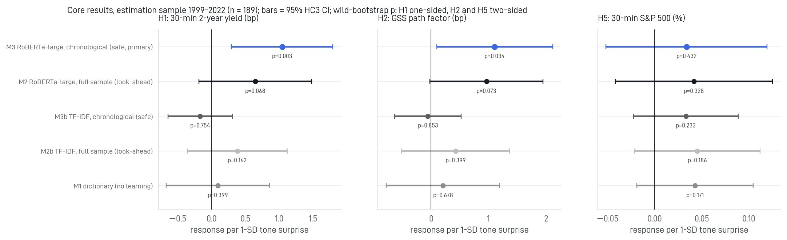

# Words vs. Rates

**Quantifying look-ahead bias in measured Federal Reserve communication effects.**
An empirical study of whether the tone of FOMC statements moves markets beyond the policy-rate surprise,
and whether language-model look-ahead changes the answer. Author: Shubhangi Pandey.

**Live dashboard:** _link added after deployment_

---

## Findings (estimation sample 1999–2022, n = 189 scheduled meetings)

| Hypothesis (plan fixed before outcomes) | Result |
| --- | --- |
| H1 Hawkish tone surprise raises the 30-min 2-year yield (beyond MP1) | **Supported:** +1.04 bp per 1-SD, one-sided wild-bootstrap p = 0.003 |
| H2 Tone explains the GSS path factor | **Supported:** +1.11 bp, two-sided p = 0.034 |
| H3 Look-ahead inflates the estimate | **Not supported:** RoBERTa difference -0.39 [-1.20, +0.24]; TF-IDF +0.55 [-0.16, +1.32] |
| H4 Same sign in the untouched 2023–26 holdout | +1.26 bp (same sign; MDE 4.8 bp; underpowered) |
| H5 Hawkish tone lowers the S&P 500 | **Not supported** on average (+0.034%, p = 0.432); positive at information-effect meetings |
| H6 Larger at the zero lower bound | **Not supported** (two-sided p = 0.951) |
| H7 Rate-sensitive industries respond more | **Not supported** |

- Yields at 2, 5, 10 and 30 years respond (Holm-adjusted p < 0.05); placebo days show nothing; the move is not reversed
  over 20 days (controlling for the pre-meeting trend).
- **Sensitivity to fine-tuning randomness.** Re-training the RoBERTa-large models with two further seeds gives primary-measure coefficients between 0.39 and 1.04 bp (2 of 3 seeds significant at 5%); averaging the three seeds' probabilities gives +0.86 bp (p = 0.005). For the full-sample model M2 the range is 0.63–0.83 bp. The pre-registered primary result is the seed-42 run.
- Classifier quality decides the conclusion: dictionary and TF-IDF measures find nothing. RoBERTa-large reaches a
  macro-F1 of 0.720, in line with Shah et al. (2023).
- Every change to the analysis plan, including those made after an independent adversarial review, is logged in
  `reports/deviations.md`.



## Design

- **Tone measures.** A 2×2 design {TF-IDF, RoBERTa-large} × {all labels (look-ahead), labels before each meeting
  (chronological)}, plus a dictionary and a ChronoBERT arm. ChronoBERT is pretrained only on text up to the year
  before the meeting.
- **Identification.** 30-minute windows (Jarociński–Karadi data, pinned commit), controlling for the policy-rate surprise.
- **Inference.** HC3, wild bootstrap and permutation tests, Holm corrections, local projections with pre-event placebo
  horizons.
- **Discipline.** Plan in `PROJECT_PLAN.md`; deviations in `reports/deviations.md`; review in `reports/review_M8.md`;
  time-stamped holdout runs (`reports/holdout_lock.json`).

## Repository layout

```
├── PROJECT_PLAN.md                 analysis plan (hypotheses, decision rules)
├── analysis/                       pipeline + common/ (paths, text, dictionary, stats, figstyle, paperdoc)
│   ├── 01_fetch_statements.py      FOMC statements 1994-2026
│   ├── 02_fetch_market.py, 02b_raw_manifest.py   surprises, FRED, Ken French, labels; SHA-256 manifest
│   ├── 03_build_events.py          statement <-> market alignment (scheduled = JK and Fed calendar agree)
│   ├── 04a-04g                     sentences, dictionary, TF-IDF, RoBERTa-large, ChronoBERT, seed robustness (GPU)
│   ├── 05_surprises.py             tone surprises, GSS factors
│   ├── 06-10c                      H1-H7, look-ahead, holdout, persistence, robustness, plan completion
│   ├── 11_figures.py, 12_compile_results.py, 13_write_reports.py
│   ├── exploratory/                analyses added after seeing results (labelled as exploratory)
│   └── run_all.py                  runs everything in order
├── app/streamlit_app.py            7-page dashboard (reads precomputed files only)
├── data/raw/                       public-domain and openly licensed inputs (see "Data and licences")
├── data/raw_manifest.json          SHA-256 of every raw file, including those re-downloaded by 02
├── data/processed/                 all derived data used by the analysis and the app
└── reports/
    ├── results.json                every number used by the README and app
    ├── deviations.md, review_M8.md, references_verified.md, holdout_lock.json
    └── figures/
```

## Reproduce

```bash
pip install -r requirements-analysis.txt   # plus a CUDA build of torch for the GPU steps (04c, 04f, 04g)
python analysis/run_all.py                 # several hours on an RTX 5070 Ti laptop GPU; the holdout step refuses
                                           # to re-run unless --force is given and logged
pip install -r requirements.txt
streamlit run app/streamlit_app.py
```

**Deploying the dashboard (Streamlit Community Cloud):** choose Python 3.12 in the app's advanced settings (the
platform ignores `runtime.txt`; pandas 3 needs Python ≥ 3.11). The app needs only `requirements.txt`.

## Data and licences

- **Included:** FOMC statement texts (Federal Reserve Board, public domain); Treasury yields and the fed funds target
  (FRED / Federal Reserve H.15, public domain); Trillion Dollar Words labels (Shah, Paturi & Chava 2023,
  **CC BY-NC 4.0: non-commercial use, with attribution**); the FOMC meeting calendar and press-conference dates.
- **Not redistributed; downloaded by `analysis/02_fetch_market.py`:** Jarociński–Karadi high-frequency surprises
  (GitHub `marekjarocinski/jkshocks_update_fed`, pinned commit), Bauer–Swanson surprises (FRBSF), VIX (Cboe, via FRED),
  Kenneth R. French Data Library portfolios. `data/raw_manifest.json` lists their SHA-256 hashes for verification.
- A research paper is in preparation. Statement tone effects are identified conditional on the rate surprise in the
  same window; see the dashboard's *Methods & data* page and `reports/deviations.md` for limitations.
